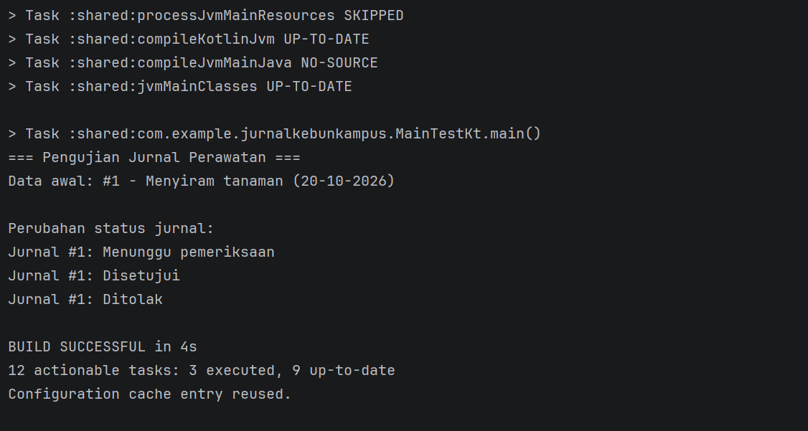
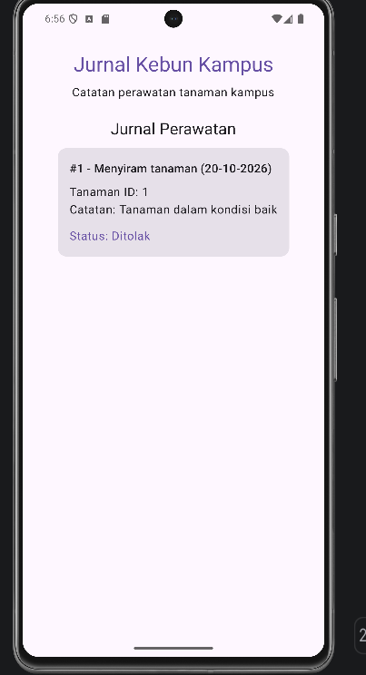

# Jurnal Kebun Kampus

## Modul 2 — Model Data, Coroutines, dan Flow

### Deskripsi
Jurnal Kebun Kampus merupakan aplikasi untuk mencatat kegiatan perawatan tanaman di lingkungan kampus. Pada modul ini, pengembangan difokuskan pada pembuatan model data, pengelolaan status jurnal, serta simulasi pengambilan dan pemantauan data menggunakan Kotlin Coroutines dan Flow.

### Model Data
Model data yang dibuat berada di `commonMain/model`, yaitu:
- `Tanaman.kt`: menyimpan informasi tanaman, seperti nama, jenis, dan lokasi.
- `JurnalPerawatan.kt`: menyimpan data kegiatan perawatan tanaman.
- `StatusJurnal.kt`: mendefinisikan tiga status jurnal, yaitu Diajukan, Disetujui, dan Ditolak.
- `JurnalExt.kt`: menyediakan fungsi untuk menampilkan label status dan ringkasan jurnal.

### Implementasi Coroutines dan Flow
Interface `Sumber<T>` menyediakan dua fungsi:
- `ambil(id)`: mengambil data jurnal secara suspend dengan simulasi jeda menggunakan `delay`.
- `pantau(id)`: memantau perubahan data jurnal menggunakan `Flow`.

Implementasi `SumberJurnalPerawatan` menggunakan data simulasi untuk menunjukkan perubahan status jurnal secara bertahap.

### Hasil Pengujian
Pengujian dilakukan melalui `MainTest.kt`. Hasil yang ditampilkan di konsol adalah:

=== Pengujian Jurnal Perawatan ===
Data awal: #1 - Menyiram tanaman (20-10-2026)

Perubahan status jurnal:
Jurnal #1: Menunggu pemeriksaan
Jurnal #1: Disetujui
Jurnal #1: Ditolak

Hasil tersebut menunjukkan bahwa data jurnal berhasil diambil dan perubahan status berhasil diamati menggunakan `Flow`.

### Anggota Kelompok
1. Bela Citra Permata Sari
2. Divania Rosanti Carfiogriffa Munthe

### Pembagian Tugas
Sesuaikan bagian ini berdasarkan kontribusi masing-masing anggota kelompok.
Bela Citra: 
- Membuat model data Tanaman, JurnalPerawatan, dan StatusJurnal. 
- Membuat extension function untuk label status dan ringkasan jurnal.
- Menerapkan Coroutines dan Flow untuk simulasi perubahan status jurnal.

Divania:
- Membuat interface Sumber<T> dan implementasi SumberJurnalPerawatan.
- Membuat dan menjalankan pengujian melalui MainTest.kt.
- Menyusun dokumentasi model data di README.

### Dokumentasi

