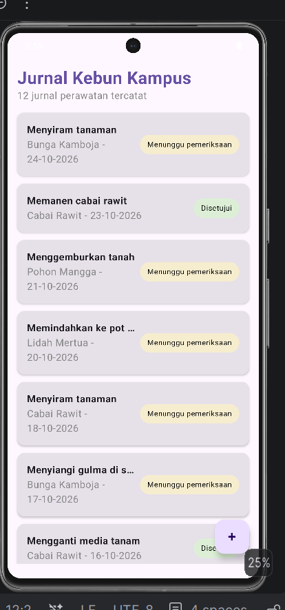

## Modul 3 — Dasar Compose Multiplatform

### Deskripsi
Pada modul ini, data model dari Modul 2 ditampilkan sebagai layar daftar jurnal perawatan tanaman menggunakan Compose Multiplatform. Kode tampilan berada di `commonMain/ui`, sehingga bisa dipakai bersama oleh Android dan desktop.

### Komponen UI
- `LabelStatus.kt`: label berbentuk pil untuk `StatusJurnal`. Warna dipilih dengan `when` pada sealed class (kuning untuk Diajukan, hijau untuk Disetujui, merah muda untuk Ditolak).
- `KartuJurnal.kt`: kartu satu jurnal. Struktur `Card` berisi `Row`, lalu `Column` (kegiatan, nama tanaman, tanggal) dan `LabelStatus` di sisi kanan. Parameter `ringkas` dan `onKlik` membuat kartu bisa dipakai ulang.
- `DaftarJurnal.kt`: `LazyColumn` dengan `key = { it.id }` untuk menampilkan banyak kartu.
- `LayarUtama.kt`: `Scaffold` berisi judul, jumlah jurnal, daftar, dan tombol tambah (FAB) yang belum berfungsi. Daftar diurutkan dengan `sortedByDescending { it.id }` agar jurnal terbaru berada di atas.
- `DataContoh.kt`: 12 data contoh `JurnalPerawatan` dan 4 data `Tanaman`.

### Checkpoint Minggu 3
- [x] LazyColumn berisi kartu jurnal dan label status dari sealed class `StatusJurnal`
- [x] Fungsi koleksi `sortedByDescending` untuk menampilkan jurnal terbaru di atas
- [x] FAB tambah jurnal (belum berfungsi)

### Pembagian Tugas Modul 3
- Bela Citra: membuat `DataContoh.kt`, `LabelStatus.kt`, `KartuJurnal.kt`, `DaftarJurnal.kt`
- Divania: Membuat `LayarUtama.kt`,  Menyusun readme dan menyambungkan `App.kt`.

### Dokumentasi Modul 3

